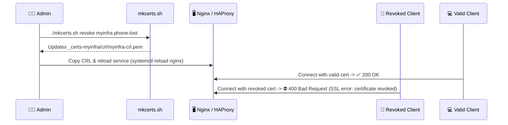

# mTLS Authentication with GnuTLS

**Author:** Fulup Le Foll (fulup@iot.bzh)  
**License:** MIT  
**Date:** March 2026 (Updated November 2026)

---

## What is mTLS and why use it?

**TLS** (Transport Layer Security) typically authenticates only the **server** — it lets a client verify it's talking to the right server (e.g., via Let's Encrypt). However, it doesn't verify who the **client** is.

**mTLS** (mutual TLS) goes further: **both the server and the client authenticate each other** using X.509 certificates. This means:

- ✅ The client verifies the server's identity (like standard HTTPS)
- ✅ The server verifies the client's identity (only authorized devices/users can connect)
- 🔒 No passwords, no VPNs, no tokens — just cryptographic proof of identity

This is ideal for **self-hosted services** (Home Assistant, Nextcloud, mail servers, APIs, etc.) where you want to ensure that only your authorized devices can reach your private services.

---

## Prerequisites

- **GnuTLS** (`certtool` command) must be installed on your system:

  ```bash
  # Fedora / RHEL / CentOS
  sudo dnf install gnutls-utils

  # Debian / Ubuntu
  sudo apt install gnutls-bin

  # Arch Linux
  sudo pacman -S gnutls
  ```

---

## Installation

Clone the repository and create your local configuration:

```bash
git clone https://github.com/Tux-Solar/mtls-gnutls-config.git
cd mtls-gnutls-config

# Create your personal config from the example
cp mkcerts.conf.example mkcerts.conf

# Edit mkcerts.conf with your organization details
```

> **Note:** `mkcerts.conf` is listed in `.gitignore` so your personal identity data is never committed. Only `mkcerts.conf.example` is versioned.

---

## Configuration

The script uses a centralized configuration system. You can have a global `mkcerts.conf` or prefix-specific overrides.

### 1. Centralized Identity (`mkcerts.conf`)

Edit this file once. These values are automatically injected into every certificate:

```bash
ORGANIZATION="MyCompany"
UNIT="IT Security"
STATE="Bretagne"
COUNTRY="FR"
UID_FIELD="admin"              # Owner of the CA
CA_CN="my-mtls-root-ca"
CA_EXPIRY_DAYS=36500          # ~100 years
SERVER_EXPIRY_DAYS=730        # 2 years
CLIENT_EXPIRY_DAYS=365        # 1 year
```

### 2. Prefix-specific Overrides

If you manage multiple separate PKIs, you can create a file named `mkcerts-{prefix}.conf` (e.g., `mkcerts-work.conf`). If it exists, the script will use it instead of the default `mkcerts.conf`.

---

## Directory Layout

All certificates generated for a prefix are cleanly organized inside `_certs-<prefix>/`:

```text
_certs-<prefix>/
├── ca/
│   ├── <prefix>-root.key         # Root CA private key (chmod 0600, ca/ directory chmod 0700)
│   └── <prefix>-root.pem         # Root CA public certificate (trust anchor)
├── servers/
│   └── <server_name>/
│       ├── <prefix>-server-<name>.key          # Private key (chmod 0600)
│       ├── <prefix>-server-<name>.pem          # Server certificate
│       ├── <prefix>-server-<name>.crt          # Full chain (server cert + root CA)
│       ├── <prefix>-server-<name>-haproxy.pem  # Full chain + private key (for HAProxy, chmod 0600)
│       └── <prefix>-root.pem                   # Copy of root CA for local reference
├── clients/
│   └── <client_name>/
│       ├── <prefix>-client-<name>.key          # Private key (chmod 0600)
│       ├── <prefix>-client-<name>.pem          # Client certificate
│       ├── <prefix>-client-<name>.crt          # Full chain (client cert + root CA)
│       ├── <prefix>-client-<name>.pfx          # PKCS#12 bundle (browser / mobile import, chmod 0600)
│       ├── <prefix>-root.pem                   # Root CA copy for device import
│       └── README.txt                          # Device installation instructions with password
├── crl/
│   └── <prefix>-crl.pem          # Certificate Revocation List
└── generation.log                # Timestamped log of all operations
```

> **Automatic Migration:** If you have an existing PKI from an earlier version with flat files, `mkcerts.sh` automatically migrates it to this structured format the first time you run a command. You can also run `./mkcerts.sh migrate <prefix>`.

---

## Usage Summary

The script follows a `command <prefix> [options]` pattern.

### Core Commands

| Command | Description |
|:---|:---|
| `init <prefix>` | Initialize the Root CA for this prefix. |
| `add-server <prefix> <host1> [host2]...` | Generate a server certificate (supports multiple DNS, IP and Wildcards) + HAProxy bundle. |
| `add-client <prefix> <name>` | Generate a client certificate (+ PKCS#12 bundle and ready-to-use client folder). |
| `all <prefix> <host> [user]` | Shortcut: Run init + add-server + add-client in one step. |

### Distribution & Management Commands

| Command | Description |
|:---|:---|
| `export-client <prefix> <name> [out.tar.gz]` | Package client `.pfx`, `root.pem`, and installation guide into a shareable archive. |
| `list <prefix>` | List all certificates generated for this prefix with CN and expiry dates. |
| `info <prefix> <name>` | Show full X.509 details for a specific certificate. |
| `check-expiry <prefix> [days]` | Check certificates expiring within N days (default: 90). Returns exit code `0` (ok), `1` (expiring soon), or `2` (expired). |
| `revoke <prefix> <name>` | Revoke a certificate (add to CRL). |
| `unrevoke <prefix> <name>` | Cancel a revocation (remove from CRL). |
| `clear-crl <prefix>` | Reset CRL to empty (clear all revocations). |
| `deploy <prefix> <host> <user@remote> [path]` | Copy server certs + root CA + CRL to a remote host via `scp`. |
| `migrate <prefix>` | Organize legacy flat directory layout into subdirectories. |

### Flags & Options

- `--force`: Place before the command to overwrite existing certificates without prompting (e.g. `./mkcerts.sh --force add-client ...`).
- `PASSWORD=xxx`: Explicitly specify the password for client `.pfx` files. If omitted in an interactive terminal, the script securely prompts for it without echoing. Defaults to `9876543210` in non-interactive environments.

---

## Step-by-Step Guide

### 1. Initialize your Root CA
```bash
./mkcerts.sh init myinfra
```
This generates the private key `ca/myinfra-root.key` (protected with `0600` permissions) and public certificate `ca/myinfra-root.pem`.

### 2. Add a Server Certificate
The script supports single hosts, multiple SANs (Subject Alternative Names), wildcards, and IPs:

**Single host (DNS or IP):**
```bash
./mkcerts.sh add-server myinfra home.example.com
./mkcerts.sh add-server myinfra 192.168.1.50
```

**Multi-SAN (mixed DNS and IP):**
```bash
./mkcerts.sh add-server myinfra iot.bzh 10.18.127.234 127.0.0.1
```

**Wildcard + Base Domain:**
Wildcards (`*.example.com`) cover only subdomains. To cover both `example.com` and all subdomains:
```bash
./mkcerts.sh add-server myinfra "*.example.com" example.com
```

### 3. Add a Client Certificate
```bash
./mkcerts.sh add-client myinfra phone-sylvain
```
Or specify the password inline:
```bash
PASSWORD=StrongPassword ./mkcerts.sh add-client myinfra phone-sylvain
```

Each client gets its own subfolder `clients/<name>/` containing:
- `<prefix>-client-<name>.pfx` (PKCS#12 bundle)
- `<prefix>-root.pem` (Root CA to trust)
- `README.txt` (Clear device import instructions)

### 4. Package and Share a Client Certificate
To send a certificate bundle to a user or mobile device:
```bash
./mkcerts.sh export-client myinfra phone-sylvain
```
This creates `myinfra-phone-sylvain-bundle.tar.gz` ready to send.

### 5. Check Expiration & Monitoring
```bash
# Check if any cert expires in the next 30 days
./mkcerts.sh check-expiry myinfra 30
```
Because `check-expiry` returns non-zero when certificates are expiring or expired, you can use it directly in cron jobs or monitoring scripts.

### 6. Revoke a Certificate
If a device is lost, stolen, or an account is decommissioned:
```bash
./mkcerts.sh revoke myinfra phone-sylvain
```
This generates or updates the Certificate Revocation List (CRL) at `_certs-myinfra/crl/myinfra-crl.pem`. See [Certificate Revocation & CRL](#certificate-revocation--crl) below for full details.

---

## Certificate Revocation & CRL

In an mTLS environment, client certificates are signed by your Root CA and typically valid for 1 year or more. If a user leaves, or a mobile phone/laptop is lost or compromised, deleting files locally does **not** stop the device from connecting, because the certificate remains cryptographically valid.

To block access immediately without having to replace your Root CA or regenerate all other client certificates, you use a **CRL (Certificate Revocation List)**.

### How Revocation Works



### 1. Revoking a Certificate
Run the `revoke` command with the prefix and the client (or server) name:

```bash
./mkcerts.sh revoke myinfra phone-sylvain
```

**What the script does:**
- Finds the certificate in `clients/phone-sylvain/` or `servers/`.
- Reads existing revoked certificates from `_certs-myinfra/crl/myinfra-crl.pem` if the CRL already exists, ensuring revocations are **cumulative** (revoking a second client will never un-revoke the first).
- Signs a fresh CRL using your Root CA private key.
- Saves the updated CRL to:
  ```text
  _certs-myinfra/crl/myinfra-crl.pem
  ```
- Logs the revocation in `_certs-myinfra/generation.log`.

### 2. Inspecting the CRL
You can inspect the contents of the generated CRL at any time using GnuTLS `certtool`:

```bash
certtool --crl-info --infile _certs-myinfra/crl/myinfra-crl.pem
```

Example output:
```text
X.509 Certificate Revocation List Information:
    Version: 2
    Issuer: UID=admin,CN=my-mtls-root-ca,OU=IT Security,O=MyCompany,ST=Bretagne,C=FR
    Update dates:
        Issued: Tue Nov 17 15:40:48 UTC 2026
        Next at: Wed Nov 17 15:40:48 UTC 2027
    Revoked certificates (2):
        Serial Number (hex): 4fe2ac14b770d1ec5e595e98ad56bcea0c440bd5
        Revoked at: Tue Nov 17 14:41:05 UTC 2026
        Serial Number (hex): 524ffcaa8993022b2c0e2600fd3ac553f3239732
        Revoked at: Tue Nov 17 15:10:22 UTC 2026
```

### 3. Enabling CRL in Nginx

1. Copy `_certs-myinfra/crl/myinfra-crl.pem` to your Nginx server (e.g. `/etc/nginx/certs/myinfra-crl.pem`).
2. Add the `ssl_crl` directive inside your `server { ... }` block:

```nginx
server {
    listen 443 ssl http2;
    server_name home.example.com;

    ssl_certificate     /etc/nginx/certs/myinfra-server-home.crt;
    ssl_certificate_key /etc/nginx/certs/myinfra-server-home.key;

    # mTLS Authentication
    ssl_client_certificate /etc/nginx/certs/myinfra-root.pem;
    ssl_verify_client on;

    # Enable CRL check
    ssl_crl /etc/nginx/certs/myinfra-crl.pem;

    location / {
        proxy_pass http://127.0.0.1:8080;
    }
}
```

3. **Reload Nginx:**  
   > [!IMPORTANT]  
   > Nginx caches the CRL file in memory when workers start. Every time a certificate is revoked and the CRL file is updated on the server, you **must reload Nginx** for the revocation to take effect:
   > ```bash
   > sudo nginx -t && sudo systemctl reload nginx
   > ```

### 4. Enabling CRL in HAProxy

In HAProxy, pass the `crl-file` option directly on the `bind` line alongside `ca-file`:

```haproxy
frontend https-in
    bind *:443 ssl crt /etc/ssl/certs/myinfra-server-home-haproxy.pem ca-file /etc/ssl/ca/myinfra-root.pem verify required crl-file /etc/ssl/ca/myinfra-crl.pem
```

Reload HAProxy after copying an updated CRL:
```bash
sudo systemctl reload haproxy
```

### 5. What Happens When a Revoked Client Connects?

- **Valid Client:** Completes the TLS handshake smoothly and receives HTTP 200 responses.
- **Revoked Client:** Nginx terminates the TLS handshake immediately during client authentication and returns:
  ```text
  400 Bad Request
  The SSL certificate error
  ```
  In Nginx's error log (`/var/log/nginx/error.log`), you will see:
  ```text
  client SSL certificate verify error: (23:certificate revoked) while reading client request headers
  ```

### 6. Can a Revocation Be Cancelled? (Restoring Access)

Yes. If a certificate was revoked by mistake or during testing, you have two ways to restore access:

#### Method A: Security Best Practice — Issue a New Certificate (Recommended in Production)
If a device was revoked due to suspected loss, theft, or key leakage, **never re-enable an untrusted private key**. Instead, re-issue a fresh certificate:
```bash
./mkcerts.sh --force add-client myinfra phone-sylvain
```
- Generates a new key pair with a **brand new serial number**.
- The compromised key remains blacklisted in your CRL forever.
- The user imports the new `.pfx` bundle and connects immediately — **without touching the CRL or reloading Nginx**.

#### Method B: Unrevoke the Certificate (Remove from CRL)
If the revocation was a configuration test or an operational error and the private key is still secure, you can unrevoke it:
```bash
./mkcerts.sh unrevoke myinfra phone-sylvain
```
- Removes `phone-sylvain` from the active revocation list.
- Rebuilds the CRL containing only the remaining revoked certificates (or an empty CRL if no other certs are revoked).
- **Reload your web server** to apply the change:
  ```bash
  sudo systemctl reload nginx
  ```

#### Method C: Reset the Entire CRL (Clear All Revocations)
To wipe all revocations and reset the CRL back to empty:
```bash
./mkcerts.sh clear-crl myinfra
sudo systemctl reload nginx
```

> [!TIP]
> **Initial Empty CRL:** When you run `./mkcerts.sh init <prefix>`, an initial, signed empty CRL is generated immediately at `_certs-<prefix>/crl/<prefix>-crl.pem`. This allows you to configure `ssl_crl` in Nginx and `crl-file` in HAProxy from Day 1 without triggering "file not found" errors during startup.

---

## Reverse Proxy Deployment

### Nginx Configuration

Copy `<prefix>-server-<name>.crt`, `<prefix>-server-<name>.key`, and `<prefix>-root.pem` to your server (or use `./mkcerts.sh deploy ...`):

```nginx
server {
    listen 443 ssl http2;
    server_name home.example.com;

    # Server Identity
    ssl_certificate     /etc/nginx/certs/myinfra-server-home-example-com.crt;
    ssl_certificate_key /etc/nginx/certs/myinfra-server-home-example-com.key;

    # mTLS Client Authentication
    ssl_client_certificate /etc/nginx/certs/myinfra-root.pem;
    ssl_verify_client on;

    # Optional: Certificate Revocation List (CRL)
    # ssl_crl /etc/nginx/certs/myinfra-crl.pem;

    location / {
        proxy_pass http://127.0.0.1:8080;
        
        # Optional: forward client identity to backend
        proxy_set_header X-SSL-Client-DN $ssl_client_s_dn;
        proxy_set_header X-SSL-Client-Verify $ssl_client_verify;
    }
}
```

### HAProxy Configuration

`mkcerts.sh` automatically generates `<prefix>-server-<name>-haproxy.pem` combining the full chain and private key:

```haproxy
frontend https-in
    bind *:443 ssl crt /etc/ssl/certs/myinfra-server-home-example-com-haproxy.pem ca-file /etc/ssl/ca/myinfra-root.pem verify required crl-file /etc/ssl/ca/myinfra-crl.pem

    # Pass client DN or UID to backend applications
    http-request set-header X-SSL-Client-DN %[ssl_c_s_dn]
    http-request set-header X-SSL-Client-UID %[ssl_c_s_dn(uid)]

    default_backend web_backend

backend web_backend
    server srv1 127.0.0.1:8080 check
```

---

## Client Device Installation

Each client needs two components:
1. **Root CA** (`<prefix>-root.pem`): Installed as a trusted CA so the device trusts your server.
2. **Client Identity** (`<prefix>-client-<name>.pfx`): Installed into the browser or system store to prove device identity.

### Android
1. Transfer `<prefix>-root.pem` and `<prefix>-client-<name>.pfx` to the device.
2. Go to **Settings > Security & Privacy > Encryption & credentials** (or **Install a certificate**).
3. Tap **CA certificate** and select `<prefix>-root.pem`.
4. Tap **VPN & app user certificate** and select `<prefix>-client-<name>.pfx` (enter password).

### iOS (iPhone / iPad)
1. Send `<prefix>-root.pem` to your device via AirDrop or Mail.
2. Go to **Settings > Profile Downloaded > Install**.
3. Go to **Settings > General > About > Certificate Trust Settings** and enable full trust for your Root CA.
4. Import `<prefix>-client-<name>.pfx` into your browser or device profile.

### Firefox (Desktop)
1. Open **Settings > Privacy & Security > Certificates > View Certificates**.
2. Under **Authorities**, click **Import...** and select `<prefix>-root.pem` (check *Trust this CA to identify websites*).
3. Under **Your Certificates**, click **Import...** and select `<prefix>-client-<name>.pfx` (enter password).

---

## Bash Autocompletion

Enable tab autocompletion for commands, prefixes, server names, and client names:

### Current session:
```bash
source mkcerts-completion.bash
```

### Permanent:
Add to `~/.bashrc`:
```bash
source /path/to/mtls-gnutls-config/mkcerts-completion.bash
```

---

## Security Best Practices

1. **Protect your Root CA**: `ca/<prefix>-root.key` is generated with `0600` permissions and the `ca/` folder with `0700`. Never copy the CA private key to server or client devices.
2. **Revocation**: If a device is lost or compromised, immediately revoke its certificate:
   ```bash
   ./mkcerts.sh revoke myinfra phone-lost
   ```
   Deploy the updated CRL (`crl/<prefix>-crl.pem`) to Nginx or HAProxy.
3. **Auditing**: Every generation, revocation, and deployment is logged to `generation.log`.

---

## License

MIT — See [LICENSE](./LICENSE) for details.
