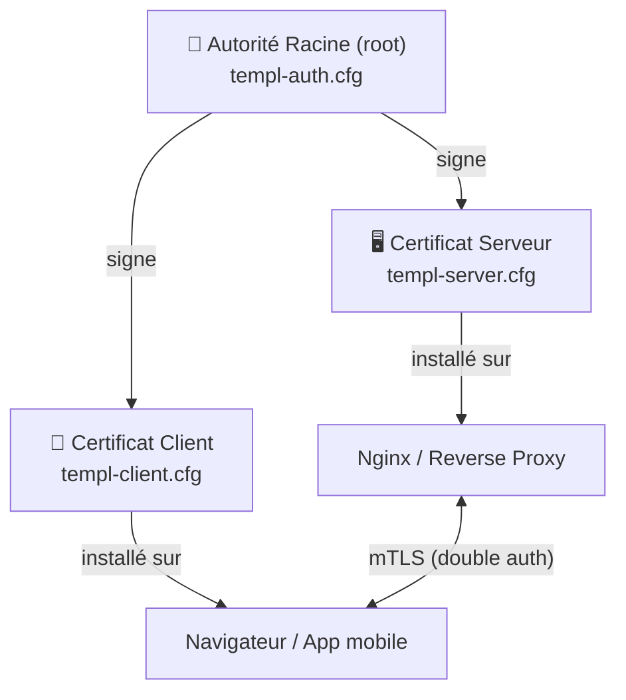
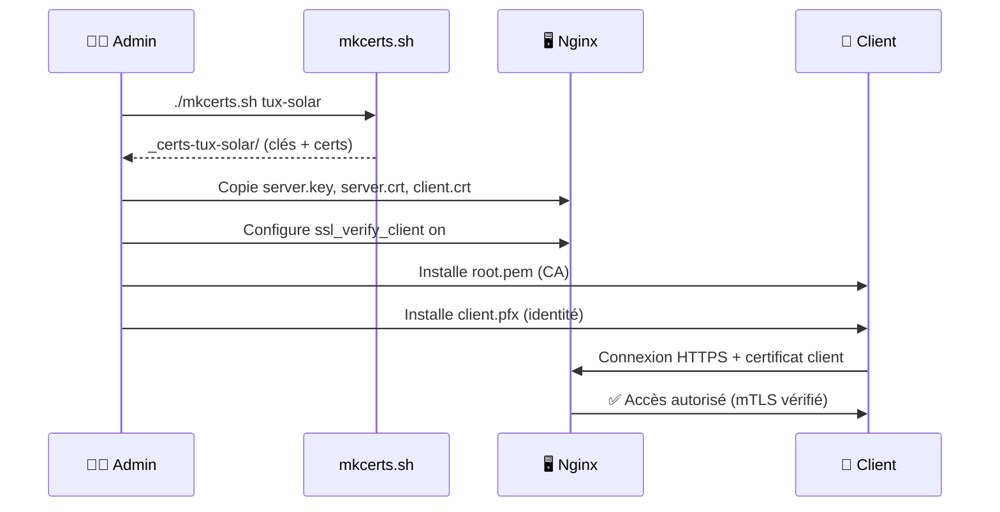

# Analyse du dépôt `mtls-gnutls-config`

## Objectif du projet

Ce dépôt fournit un **kit clé-en-main pour mettre en place une authentification mTLS** (mutual TLS) à l'aide de **GnuTLS** (`certtool`). Le but est de sécuriser des services auto-hébergés (home server) en authentifiant **non seulement le serveur** (comme le fait Let's Encrypt), mais aussi **le client** — garantissant que seuls les appareils possédant un certificat signé par vous peuvent accéder à vos services.

> [!IMPORTANT]
> mTLS est une alternative au VPN pour protéger des services personnels : seuls les clients ayant un certificat client valide peuvent se connecter.

---

## Architecture PKI générée

Le script génère une **PKI (Public Key Infrastructure) à 3 niveaux** :



---

## Fichiers du dépôt

| Fichier | Rôle |
|---|---|
| [mkcerts.sh](file:///home/sylvain/Work/PROJETS/mtls-gnutls-config/mkcerts.sh) | Script principal de génération des certificats |
| [templ-auth.cfg](file:///home/sylvain/Work/PROJETS/mtls-gnutls-config/templ-auth.cfg) | Template GnuTLS pour l'autorité racine (CA) |
| [templ-server.cfg](file:///home/sylvain/Work/PROJETS/mtls-gnutls-config/templ-server.cfg) | Template GnuTLS pour le certificat serveur |
| [templ-client.cfg](file:///home/sylvain/Work/PROJETS/mtls-gnutls-config/templ-client.cfg) | Template GnuTLS pour le certificat client |
| `docs/` | Screenshots pour l'installation des certificats sur Android |
| [.gitignore](file:///home/sylvain/Work/PROJETS/mtls-gnutls-config/.gitignore) | Ignore les dossiers `_*` (les certificats générés) |

---

## Détail du script [mkcerts.sh](file:///home/sylvain/Work/PROJETS/mtls-gnutls-config/mkcerts.sh)

### Utilisation

```bash
./mkcerts.sh mon-prefix               # mot de passe par défaut : 9876543210
PASSWORD=monmdp ./mkcerts.sh mon-prefix  # mot de passe personnalisé
```

Les certificats sont créés dans `_certs-{prefix}/`.

### Les 3 fonctions

#### 1. `make_root_certificate root`
- Génère une **clé privée ECDSA** (courbe `secp256r1`)
- Crée un certificat **auto-signé** (CA) avec [templ-auth.cfg](file:///home/sylvain/Work/PROJETS/mtls-gnutls-config/templ-auth.cfg)
- Fichiers produits : `{prefix}-root.key` + `{prefix}-root.pem`

#### 2. `make_server_certificate server root`
- Génère une clé privée ECDSA pour le serveur
- Crée un certificat **signé par la CA racine** avec [templ-server.cfg](file:///home/sylvain/Work/PROJETS/mtls-gnutls-config/templ-server.cfg)
- Concatène certificat serveur + CA → `{prefix}-server.crt` (full chain)
- Fichiers produits : `{prefix}-server.key`, `{prefix}-server.pem`, `{prefix}-server.crt`

#### 3. `make_client_certificate client root`
- Génère une clé privée ECDSA pour le client
- Crée un certificat **signé par la CA racine** avec [templ-client.cfg](file:///home/sylvain/Work/PROJETS/mtls-gnutls-config/templ-client.cfg)
- Concatène certificat client + CA → `{prefix}-client.crt` (full chain)
- Exporte en **PKCS#12 (.pfx)** pour installation facile dans les navigateurs/mobiles
- Fichiers produits : `{prefix}-client.key`, `{prefix}-client.pem`, `{prefix}-client.crt`, `{prefix}-client.pfx`

---

## Détail des templates de certificats

### [templ-auth.cfg](file:///home/sylvain/Work/PROJETS/mtls-gnutls-config/templ-auth.cfg) — Autorité Racine (CA)

| Paramètre | Valeur | Signification |
|---|---|---|
| `organization` | Follijen | Nom de l'organisation |
| `cn` | tux-solar@follijen-mtls | Nom commun de la CA |
| `expiration_days` | 36500 (~100 ans) | Durée de validité très longue |
| [ca](file:///home/sylvain/Work/PROJETS/mtls-gnutls-config/mkcerts.sh#20-35) | activé | Marqué comme certificat CA |
| `cert_signing_key` | activé | Autorisé à signer d'autres certificats |
| Extension custom | OID `1.3.9.812.383.370.36.1` | Extension métier personnalisée |

### [templ-server.cfg](file:///home/sylvain/Work/PROJETS/mtls-gnutls-config/templ-server.cfg) — Certificat Serveur

| Paramètre | Valeur | Signification |
|---|---|---|
| `cn` | tux-solar.fridu.bzh server | Identité du serveur |
| `dns_name` | tux-solar.fridu.bzh | Nom DNS du serveur (pour validation TLS) |
| `expiration_days` | 36400 (~99 ans) | Durée de validité |
| [ca](file:///home/sylvain/Work/PROJETS/mtls-gnutls-config/mkcerts.sh#20-35) | activé | Marqué CA (inhabituel pour un cert serveur) |
| `tls_www_server` | activé | Usage : authentification serveur TLS |

### [templ-client.cfg](file:///home/sylvain/Work/PROJETS/mtls-gnutls-config/templ-client.cfg) — Certificat Client

| Paramètre | Valeur | Signification |
|---|---|---|
| `cn` | tux-solar.fridu.bzh client | Identité du client |
| `dns_name` | follijen.freeboxos.fr | Nom DNS associé |
| `expiration_days` | 36300 (~99 ans) | Durée de validité |
| [ca](file:///home/sylvain/Work/PROJETS/mtls-gnutls-config/mkcerts.sh#20-35) | désactivé (commenté) | N'est pas une CA |
| `tls_www_client` | activé | Usage : authentification client TLS |
| `path_len` | 6 | Longueur de chaîne autorisée |

---

## Flux de déploiement



---

## Points à noter

> [!WARNING]
> **Bug mineur dans [mkcerts.sh](file:///home/sylvain/Work/PROJETS/mtls-gnutls-config/mkcerts.sh) (ligne 8-9)** : il y a des espaces parasites dans les affectations par défaut :
> ```bash
> destination= _cert    # espace avant _cert
> prefix= "mtls"        # espace avant "mtls"
> ```
> Ces espaces causeront des erreurs si le script est appelé sans argument.

> [!NOTE]
> - Toutes les clés utilisent **ECDSA avec la courbe secp256r1** (P-256), un bon choix de sécurité/performance
> - Le protocole TLS est limité à **TLSv1.3** dans la config Nginx d'exemple
> - Les certificats ont des durées de vie très longues (~100 ans), adaptées à un usage personnel
> - Le [.gitignore](file:///home/sylvain/Work/PROJETS/mtls-gnutls-config/.gitignore) avec `_*` empêche de committer accidentellement les certificats générés

